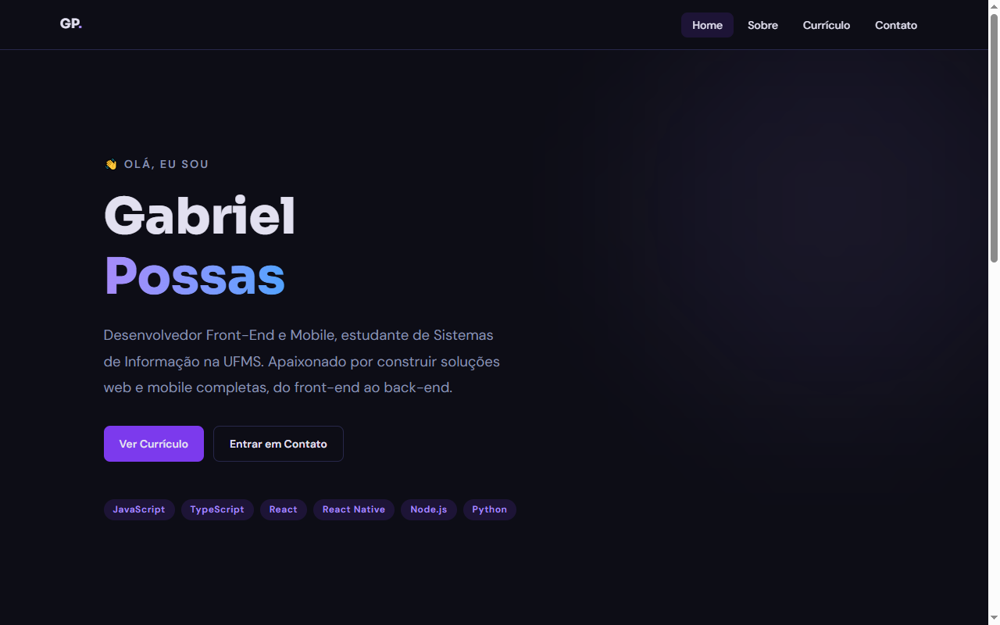
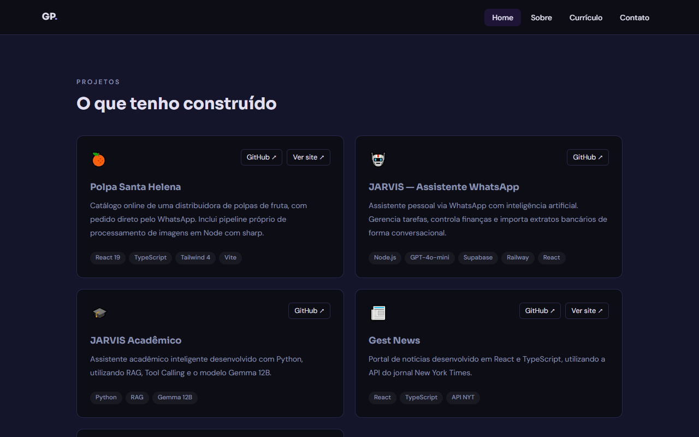

# Portfólio — Gabriel Possas

Site pessoal com projetos, trajetória e formas de contato.
No ar em **[portfolio-gabrielpossasb.vercel.app](https://portfolio-gabrielpossasb.vercel.app/)**.


---

## Telas

| Home | Projetos | Currículo |
|:--:|:--:|:--:|
|  |  |  |

---

## Páginas

| Rota | Conteúdo |
|---|---|
| `/` | Apresentação e projetos |
| `/sobre` | Trajetória, stack e interesses |
| `/curriculo` | Formação, experiência e competências |
| `/contato` | Formulário e redes sociais |

---

## Decisões técnicas

**Formulário sem backend.** O contato usa EmailJS, que envia direto do
navegador. Evita manter um servidor no ar só para receber mensagem, em um site
que de resto é estático.

**Tema por variáveis.** As cores e fontes ficam em tokens CSS consumidos pelo
Tailwind 4, então o tema muda em um lugar só, sem caçar classe por componente.

**SPA com rotas reais.** React Router 7 com rewrite na Vercel, para que
`/curriculo` funcione em acesso direto e não apenas por navegação interna.

---

## Stack

| | |
|---|---|
| Front-end | React 19, TypeScript, React Router 7 |
| Estilo | Tailwind CSS 4, PostCSS |
| Build | Vite |
| Formulário | EmailJS |
| Qualidade | ESLint, TypeScript strict |
| Deploy | Vercel, publicação a cada push na `main` |

---

## Como rodar

Requer Node.js 20 ou superior.

```bash
git clone https://github.com/Gabrielpossasb/Portfolio.git
cd Portfolio
npm install
npm run dev
```

Abre em `http://localhost:5173`.

| Comando | O que faz |
|---|---|
| `npm run dev` | Servidor de desenvolvimento |
| `npm run build` | Checagem de tipos + build em `dist/` |
| `npm run preview` | Serve o build local |
| `npm run lint` | ESLint |

### Variáveis de ambiente

O formulário de contato precisa das credenciais do EmailJS em um `.env` na raiz:

```
VITE_EMAILJS_SERVICE_ID=
VITE_EMAILJS_TEMPLATE_ID=
VITE_EMAILJS_PUBLIC_KEY=
```

---

## Estrutura

```
src/
├── components/   # Navbar, Footer, Layout
├── pages/        # uma por rota
├── App.tsx       # rotas
└── index.css     # tokens de tema
```
